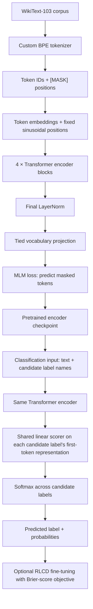
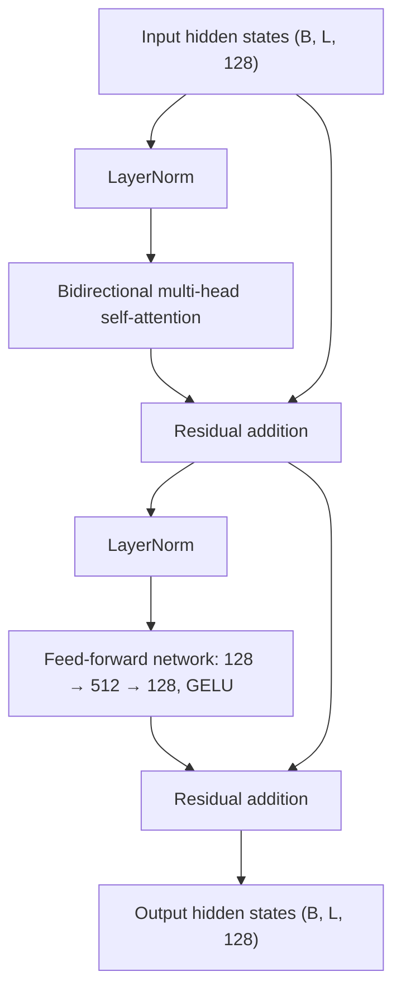

# Yak

Yak is an open source reimplementation of JEV, built from the ground up by a small team. The goal is simple: no black boxes. We write the tokenizer ourselves, pretrain a compact transformer ourselves, fine-tune it ourselves, and measure how well it knows what it doesn't know.

The name comes from the yak, an animal that is small enough to look unassuming and tough enough to work at altitude. That is roughly the spirit we are going for: a modest model that holds up under real evaluation.

## Status

| Stage | State |
|-------|-------|
| Tokenizer | Done |
| MLM pretraining | Done. A pretrained checkpoint exists (results below). |
| Dataset download for fine-tuning | Done. Banking77 and CLINC come from a script, SNLI from a notebook. |
| Preprocessing | Done. One script writes the train, validation and test files for all three datasets. |
| Supervised fine-tuning | First mixture experiment complete. Results and calibration baselines are reported below. |
| RLCD (Reinforcement Learning for Calibrated Decisions) | First Brier-objective run complete (seed 0). It improved some metrics, but did not meet the pre-defined calibration success criteria on all three tasks. |
| Unseen-data benchmark | Done. Zero-shot results are reported for Emotion and SST-2, with two candidate-label wordings each. AG News is excluded from this benchmark scope. |

This README is updated as each stage lands. Sections marked "planned" describe what we intend to build, not what exists today.

## What we are building

Yak is a small encoder-style transformer trained with masked language modeling (MLM), then fine-tuned for classification on general NLP tasks and evaluated for both accuracy and calibration.

The pipeline has six pieces:

1. A byte pair encoding (BPE) tokenizer implemented from scratch, with no tokenizer libraries doing the heavy lifting.
2. A pretraining corpus. We used WikiText-103, a cleaned Wikipedia dump. Adding BookCorpus is still possible later.
3. An MLM pretraining run using our own tokenizer.
4. Supervised fine-tuning on Banking77, CLINC and SNLI, in which the model reads the candidate label names next to the text.
5. RLCD, which trains the fine-tuned model to give calibrated probabilities, using the Brier score as the reward.
6. Evaluation with accuracy, Brier score and calibration measures.

## Model architecture

Yak uses a compact, **encoder-only Transformer**. The same encoder is first pretrained with masked language modelling (MLM), then adapted for classification by replacing the MLM output head with a small candidate-label scoring head.

### End-to-end training flow



### Inside one Transformer encoder block



There are four such blocks stacked sequentially. Each attention layer uses four heads (32 dimensions per head), and attention is bidirectional: each token can use context from tokens on either side. The implementation uses scaled dot-product attention and applies a padding mask when needed.

### How classification works

Unlike a conventional classifier with a fixed output neuron for every class, Yak places the candidate label names in the input sequence. For example:

```text
[CLS] I need help with my card [SEP]
card_arrival [SEP] cash_withdrawal [SEP] cash_withdrawal_charge [SEP] ...
```

The encoder produces one contextual representation per token. The first token of each candidate label is passed through the **same shared linear scoring layer** (128 inputs → 1 score). A softmax over candidate scores produces the probability distribution across the labels supplied for that example.

This means the output layer is not tied to a fixed number of classes: candidate labels are represented as text, and labels not seen during fine-tuning can still be supplied at inference time. The scorer adds 129 parameters (128 weights and one bias). During training, candidate-label subsets and their order are varied so the model does not depend on a fixed label position.

### Main dimensions

| Component | Configuration |
|---|---|
| Token embedding | 30,005 × 128 |
| Positional information | Fixed sinusoidal, length 2,048 |
| Transformer encoder | 4 blocks |
| Attention per block | 4 bidirectional heads, 32 dimensions per head |
| Feed-forward network | 128 → 512 → 128, GELU |
| Classification scorer | Shared Linear(128, 1) |
| Classification probabilities | Softmax over the candidate labels in the input |

**Two output heads, one shared encoder:** during MLM pretraining, the encoder feeds a vocabulary projection whose weights are tied to the token embedding matrix. For classification fine-tuning, that vocabulary projection is replaced by the shared candidate-label scorer. RLCD starts from the SFT classifier and optimises the Brier-score objective; it does not introduce a separate encoder architecture.

## Model configuration

This is the configuration of the pretrained checkpoint.

| Parameter | Value |
|-----------|-------|
| d_model | 128 |
| n_head | 4 |
| n_layers | 4 |
| d_ff | 512 |
| vocab_size | 30,005 (30,000 vocabulary entries plus 5 special tokens) |
| max_seq_len | 2,048 |
| positional encoding | static sinusoidal (sin and cos), not learned |
| special tokens | [PAD], [UNK], [CLS], [SEP], [MASK] |

With 4 heads and a model width of 128, each attention head works in 32 dimensions. The model has about 4.7M parameters. Of those, 3.84M are the token embedding table, which is shared with the output layer, and only 0.79M are in the four transformer layers. Positions use a fixed sin and cos table, so they add no parameters.

The embedding table is most of the model. That is the main reason it is capacity limited: during pretraining, training loss and validation loss ended up equal, so more steps help but with shrinking returns.

We also ran a larger variant (d_model 256, 6 layers, about 12.4M parameters) as an experiment. It was only trained for a short run, so its numbers are not comparable with the checkpoint above. The notebook is in `Model/Yak_MLM_12M.ipynb`.

## Pretraining results

Pretraining ran on WikiText-103 in Colab and Kaggle notebooks, in several phases with a warm restart of the learning rate at the start of each. Batches were 131,072 tokens (64 sequences of 2,048 tokens). Dropout was turned off in the later phases. About 0.5 percent of articles are held out for validation.

| Checkpoint | Validation loss | Masked token accuracy | Lift over the baseline |
|------------|-----------------|-----------------------|------------------------|
| Frequency baseline (always predict "the") | n/a | 4.77% | n/a |
| Step 24,000 | 4.34 | 33.1% | +28.3 points, 6.9x |
| Step 36,000 | 3.40 | 43.4% | +38.6 points, 9.1x |
| Latest checkpoint | n/a | about 48% | +43.2 points, 10.1x |

Accuracy is measured on masked positions only, with a fixed set of masks so numbers stay comparable between runs. The baseline is the accuracy of a model that ignores the context and always guesses the most frequent token, which is "the", and it scores 4.77%. Lift is how far a checkpoint sits above that baseline, in percentage points and as a multiple. From the 4.77% baseline to about 48% is a lift of roughly 43 points, about ten times the baseline.

Checkpoints are not stored in the repository because of their size. They are kept in cloud storage and are excluded by `.gitignore`.

## Roadmap

| Week | Stage | What we do | Deliverable |
|------|-------|------------|-------------|
| 1 | Tokenizer (done) | Implement byte pair encoding from scratch, train it with a 30,000 vocabulary, and add special tokens for padding, unknown, classification, separation and masking. | Standalone BPE module, trained tokenizer file (`Tokenizer/TokenFile/bpe.json`), and token statistics |
| 2 | MLM pretraining (done) | Pretrain the 4 layer model with a masked language modeling objective on sequences packed to a 2,048 token context. | Pretrained Yak checkpoint and training logs |
| 3 | Supervised fine-tuning (first experiment done) | Download Banking77, CLINC and SNLI, adapt the text to the tokenizer, and fine-tune the pretrained encoder on all three at once. Details and results below. | Fine-tuning notebook, preprocessing script, and results (`runs/mixture/results.json`) |
| 4 | RLCD (first run complete) | Fine-tune the SFT checkpoint with the Brier objective. The first run used seed 0, 3 epochs and 500 steps per epoch. Results did not satisfy the calibration acceptance criteria on every task. | `yak-rlcd-and-benchmarking.ipynb`; checkpoint output is generated under `runs/rlcd/` |
| 5 | Unseen-data benchmark (done) | Evaluate zero-shot transfer to datasets not used for training. Emotion and SST-2 are included, each with two candidate-label wordings. AG News is excluded from the benchmark scope. | `yaak-benchmark.ipynb` and `runs/benchmark/results_benchmark.json` |

## Week 3: Supervised fine-tuning

### Datasets and preparation

| Dataset | Task | Labels | Splits |
|---------|------|--------|--------|
| Banking77 | Banking intents | 77 | train 10,003, test 3,080 (no validation split) |
| CLINC | 150 intents plus out-of-scope | 151 | train 15,100, validation 3,100, test 5,500 |
| SNLI | Sentence pair inference | 3 | train 549,367, validation 9,842, test 9,824 (pairs with no gold label are dropped) |

The preprocessing script, `SftPreprocessing/Preprocessing.py`, turns the three datasets into one set of files in `Data/processed/`. Each line of `train.jsonl`, `validation.jsonl` and `test.jsonl` is one example: the text (or the premise and hypothesis) and the label as a readable name such as `card_arrival`, never a number. Banking77 has no validation split, so 10 percent of its training data is set aside with a fixed seed. The training set is balanced to the smallest dataset, which gives 9,003 examples from each dataset, 27,009 in total. Validation (13,942) and test (18,404) are left unbalanced. SNLI is not committed because of its size, so it is recreated from Hugging Face by `Data/snli.ipynb`.

Text is normalised the way WikiText was before it reaches the tokenizer: punctuation is split off from words and apostrophes are spaced, so downstream text looks like the text the model was pretrained on.

### How the model classifies

The model does not have one output per class. The candidate label names go into the input instead:

```
[CLS] text [SEP] label1 [SEP] label2 [SEP] ... [SEP]
```

The encoder reads the text and the labels together. One shared linear scorer, which adds only 129 new parameters, scores the first token of each label, and a softmax over those scores gives the probabilities. This replaces the MLM output layer, so the whole model is about 4.63M parameters.

- **Labels are re-drawn every time.** During training an example shows either all of its dataset's labels or a random subset, and the order is reshuffled each time the example is used, so the model cannot learn that a label sits in a particular position. Labels never cross from one dataset to another.
- **Evaluation can average several label orders.** The results below use 4.
- **Unseen labels can be scored.** Because the model reads the label words, a label it never saw in training can still be a candidate. The largest number of candidates in one example is 151 (CLINC), which is where `max_label = 151` comes from.

### Held-out classes

To check that labels are read and not just memorised, 15 of the 77 Banking77 classes and 30 of the 151 CLINC classes are held out of training. Neither their examples nor their names appear. They are scored afterwards, with all classes as candidates. SNLI has only 3 labels and nothing is held out.

### Training

The notebook is `Model/OurExperiments/FineTuning/Yak_Finetune_Mixture.ipynb`, with helper code in the `Utils/` folder next to it. It starts from the pretrained checkpoint and trains on all three datasets at once. Every batch comes from one dataset, picked at random with equal weights. Batch sizes are 32 for Banking77, 16 for CLINC (its inputs are longer because of the 151 labels) and 64 for SNLI. Training ran for 6 epochs of 1,000 steps each, with a learning rate of 2e-4, and the best epoch was chosen by mean validation accuracy on the seen classes. An epoch took about 15 minutes on a local machine.

### Results

Test split, averaging 4 label orders, with a temperature fitted on validation data. Chance is 1 divided by the number of classes. A model that guessed uniformly would have a Brier score of 0.987 on Banking77, 0.993 on CLINC and 0.667 on SNLI. ECE is expected calibration error. Lower is better for both Brier and ECE.

| Test set | Accuracy | Chance | Brier | ECE |
|----------|----------|--------|-------|-----|
| Banking77, classes seen in training | 49.5% | 1.3% | 0.620 | 0.064 |
| Banking77, held-out classes | 18.3% | 1.3% | 0.961 | 0.141 |
| CLINC, classes seen in training | 48.6% | 0.7% | 0.655 | 0.040 |
| CLINC, held-out classes | 28.0% | 0.7% | 0.905 | 0.112 |
| SNLI | 47.1% | 33.3% | 0.625 | 0.013 |

On CLINC, in-scope accuracy is 58.1%. The out-of-scope class has a recall of 14.5% and a precision of 69.7%, and 1.8% of in-scope examples are wrongly flagged as out-of-scope. The fitted temperatures are 0.91 for Banking77, 1.02 for CLINC and 2.95 for SNLI.

What these numbers say:

- **Labels are being read.** On classes it never saw in training, the model scores 18.3% on Banking77 and 28.0% on CLINC, about 14 and 40 times chance. That is far below its accuracy on seen classes, but it is not memorisation.
- **SNLI is the weakest task.** 47.1% is only 14 points above chance. The model has no segment embeddings and was pretrained on single text, so pairs are hard for it.
- **Temperature matters most on SNLI.** Its raw probabilities were badly over-confident (a temperature of 2.95). Scaling brings its ECE from 0.196 down to 0.013 and its Brier score from 0.698 to 0.625.
- **Out-of-scope detection is poor.** The model rarely says "out of scope" (recall 14.5%).
- **Training was not run to convergence.** Validation accuracy was still rising slowly at epoch 6.

### Remaining work

- Run additional supervised fine-tuning experiments; validation accuracy was still improving slowly at the end of the first run.
- Repeat RLCD with multiple seeds (the current run uses seed 0 only).
- The unseen-data benchmark is complete for the selected Emotion and SST-2 datasets; AG News is outside the current scope.
- Compare RLCD against temperature scaling and other simple calibration baselines on the same evaluation protocol.

The first RLCD run and the unseen-data benchmark are documented below.

## Week 4: RLCD with a Brier score objective

The first RLCD experiment is implemented in `Model/OurExperiments/FineTuning/yak-rlcd-and-benchmarking.ipynb`. It starts from the supervised `best.pt` checkpoint and fine-tunes the model using the multiclass Brier score:

```
Brier = sum_k (p_k - y_k)^2
```

Minimising Brier is equivalent to maximising its negative as a reward. It is a differentiable objective, so this implementation optimises it directly rather than sampling discrete actions. All model weights are trainable. The run uses the same three-task mixture, a low learning rate, and an accuracy guard: an epoch is eligible only if mean seen-class validation accuracy remains within 0.01 of the SFT baseline. Among eligible epochs, the checkpoint with the lowest mean validation Brier score is retained.

**Run configuration:** seed 0; 3 epochs; 500 steps per epoch; learning rate 2e-5 for the encoder and 1e-4 for the scoring head; four label orders at test time. This is a single-seed experiment, not a final multi-seed result.

### Test results: seen classes

The table compares the original SFT model, SFT with temperature fitted on validation data, RLCD, and RLCD with its own validation-fitted temperature. Accuracy is higher-is-better; Brier and ECE are lower-is-better.

| Dataset | Model | Accuracy | Brier | ECE |
|---------|-------|----------|-------|-----|
| Banking77 | SFT | 49.5% | 0.626 | 0.084 |
| Banking77 | SFT + temperature | 49.5% | 0.620 | 0.064 |
| Banking77 | RLCD | 50.6% | 0.616 | 0.083 |
| Banking77 | RLCD + temperature | 50.5% | 0.611 | 0.062 |
| CLINC | SFT | 48.6% | 0.655 | 0.035 |
| CLINC | SFT + temperature | 48.6% | 0.655 | 0.040 |
| CLINC | RLCD | 48.9% | 0.644 | 0.038 |
| CLINC | RLCD + temperature | 48.8% | 0.644 | 0.042 |
| SNLI | SFT | 47.1% | 0.698 | 0.196 |
| SNLI | SFT + temperature | 47.1% | 0.625 | 0.013 |
| SNLI | RLCD | 47.3% | 0.704 | 0.206 |
| SNLI | RLCD + temperature | 47.3% | 0.624 | 0.013 |

### Did RLCD improve the metrics?

**Not consistently, and it did not pass the pre-defined success criteria.**

- **Banking77:** RLCD improves accuracy from 49.5% to 50.6% and Brier from 0.626 to 0.616. ECE changes only from 0.084 to 0.083, and remains worse than the temperature-scaled SFT ECE of 0.064.
- **CLINC:** RLCD improves accuracy from 48.6% to 48.9% and Brier from 0.655 to 0.644. ECE is 0.038, slightly worse than the raw SFT value of 0.035.
- **SNLI:** RLCD increases accuracy slightly from 47.1% to 47.3%, but raw Brier and ECE become worse (0.704 and 0.206 versus 0.698 and 0.196 for SFT). Temperature scaling remains highly effective.

The notebook's acceptance test requires RLCD's Brier and ECE to beat both SFT and temperature-scaled SFT while keeping accuracy within the agreed tolerance. The run reports **FAIL for Banking77, CLINC and SNLI**. This is the measured outcome, not a successful calibration claim.

The practical takeaway is that direct Brier optimisation showed some promise for accuracy and Brier on two tasks, but did not reliably improve calibration over the simpler temperature-scaling baseline. The current experiment is exploratory: it uses one seed, so the results need repeat runs before drawing a strong conclusion.

## Week 5: benchmark on unseen datasets

The benchmark notebook is `Model/OurExperiments/FineTuning/yaak-benchmark.ipynb`. It evaluates the SFT checkpoint and, when available, the seed-0 RLCD checkpoint on datasets and class names not used during training. It averages four candidate-label orders and tests two label wordings per dataset.

The committed artifact `runs/benchmark/results_benchmark.json` contains the completed benchmark results for **Emotion (2,000 test examples)** and **SST-2 (872 test examples)**. AG News is intentionally excluded from the benchmark scope because this evaluation focuses on the selected datasets.

### Zero-shot benchmark results

No labelled examples from Emotion or SST-2 are used to train Yak. The TF-IDF + logistic-regression row is a supervised reference trained on 1,000 labelled examples; it is not a zero-shot baseline.

| Dataset | Label wording | Model | Accuracy | Brier | ECE |
|----------|---------------|-------|----------|-------|-----|
| Emotion | plain | SFT | 14.95% | 0.929 | 0.199 |
| Emotion | plain | RLCD reference | 13.70% | 0.937 | 0.215 |
| Emotion | adjective | SFT | 17.90% | 0.845 | 0.127 |
| Emotion | adjective | RLCD reference | 17.80% | 0.847 | 0.127 |
| SST-2 | plain | SFT | 50.57% | 0.507 | 0.062 |
| SST-2 | plain | RLCD reference | 50.00% | 0.508 | 0.059 |
| SST-2 | good/bad | SFT | 46.67% | 0.539 | 0.140 |
| SST-2 | good/bad | RLCD reference | 45.87% | 0.542 | 0.150 |

The benchmark also reports these supervised TF-IDF + logistic-regression reference accuracies: 53.30% on Emotion and 66.63% on SST-2. These references use 1,000 labelled training examples, while Yak receives no benchmark labels.

**Interpretation:** the results are weak on these two transfer tasks and sensitive to candidate-label wording. RLCD does not show a consistent zero-shot advantage over SFT in the committed benchmark artifact. For plain labels, diagnostic temperature fitting improves SFT calibration (Emotion ECE 0.199 to 0.039; SST-2 ECE 0.062 to 0.019), but this uses 1,000 labelled benchmark training examples and must not be described as zero-shot performance.

## Repository layout

```
Data/
  DownloadData.py       downloads and prepares Banking77 and CLINC (and SNLI from Stanford's site)
  BaseData.py, Banking77.py, Clinic.py, Snli.py, FileUtils.py    the classes and helpers it uses
  snli.ipynb            downloads SNLI from Hugging Face and writes the SNLI csv files
  banking77/, clinc/    the prepared datasets
  processed/            train.jsonl, validation.jsonl, test.jsonl and label_metadata.json
SftPreprocessing/
  Preprocessing.py      builds Data/processed/ from the three datasets
Model/
  MlmModel.py, EncoderBlock.py, LayerOne/, LayerTwo/, LayerThree/    the transformer
  OurExperiments/
    Pretraining/        the pretraining notebooks
    FineTuning/         the fine-tuning notebook and Utils/ (tokenizer wrapper, dataset mixing, metrics, inference)
Tokenizer/              BPE implementation and the trained tokenizer file
runs/mixture/           results.json from the first fine-tuning run
Eval/                   (planned) Brier score, calibration and benchmark evaluation
README.md
```

Banking77, CLINC and the processed files are small and are kept in the repository. SNLI is not, because it has about 550,000 training pairs: recreate it with `Data/snli.ipynb`. Model checkpoints (`*.pt`) are too large for the repository and are kept in cloud storage.

## Getting started

### Prepare the fine-tuning data

Run these from the repository root, in this order. On Windows use `python`, not `python3`.

```
python Data/DownloadData.py --only banking77 clinc
```

This writes `Data/banking77/` and `Data/clinc/`. Useful options are `--force` to redo everything, `--out <folder>` to write somewhere else, and `--delete-raw` to remove the downloaded source files at the end. If a download fails with a certificate error, which can happen behind a company proxy or antivirus that inspects HTTPS, try `pip install --upgrade certifi` or pass `--cafile` with your organisation's certificate bundle. `--insecure` turns certificate checking off and is a last resort.

Then SNLI. Run `Data/snli.ipynb` once (it needs the `datasets` package). It writes `Data/snli_train.csv`, `Data/snli_validation.csv` and `Data/snli_test.csv`. These files are large and stay on your machine. `python Data/DownloadData.py --only snli` fetches it from Stanford's site instead, but that server is not reachable from every network.

Finally, build the training files:

```
python SftPreprocessing/Preprocessing.py
```

This writes `train.jsonl`, `validation.jsonl`, `test.jsonl` and `label_metadata.json` into `Data/processed/`. A correct run reports 27,009 training, 13,942 validation and 18,404 test records, and a maximum of 151 labels. The result is deterministic, since the script uses a fixed seed. If any of the three `.jsonl` files is missing from your checkout, this script is what creates it. The fine-tuning notebook stops with an error if one of them is absent.

### Fine-tune

Open `Model/OurExperiments/FineTuning/Yak_Finetune_Mixture.ipynb`, point `CKPT` at the pretrained checkpoint, and run it from anywhere inside the repository. Results are written to `runs/mixture/`.

### Other setup

Setup instructions for pretraining will be added as that code is cleaned up. The plan is for everything to be runnable from a clean checkout with a single environment file and a handful of documented commands.

## Contributing

Yak is a team project and we welcome outside help once the core pipeline is stable. If you want to contribute:

- Open an issue before starting large changes so we can avoid duplicated work.
- Keep pull requests focused. One change, one PR.
- Add tests for anything that touches the tokenizer, since silent tokenization bugs are painful to find later.
- Do not commit datasets or checkpoints.

## Team

Maintained by the Yak team. Contributor names will be added here.

## License

To be decided before the first public release.

## Acknowledgments

Yak is inspired by JEV, and builds on public datasets including WikiText-103, Banking77, CLINC and SNLI. Thanks to everyone who made those resources available. We thank all who 